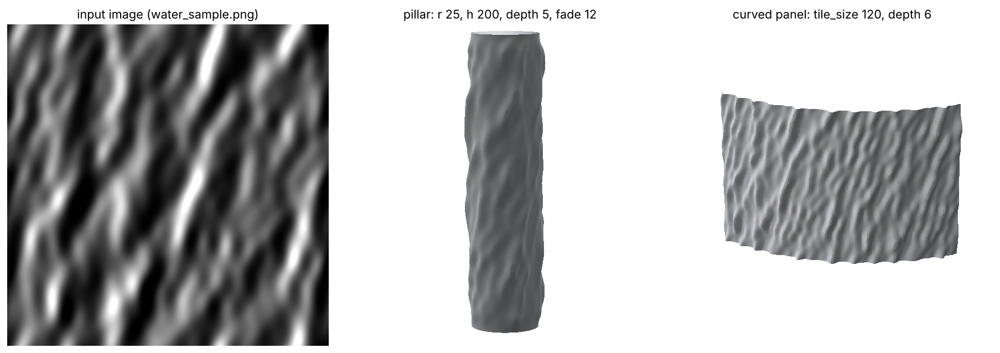

# 03 – Image Relief

**Status:** 🟨 In progress

## Brief
Turn an image into real geometry on a flat or curved surface: a pillar with
a water-wave texture, a facade panel with a stone pattern, a wall with a
portrait. The surface moves along its normals by each pixel's
brightness, so the relief **is the mesh**. This isn't a normal or
displacement map that only shows up in a render. You can bake it, section it,
3D print it or mill it.

## Files
- `image_relief.py`: the script for the Rhino 8 **Python 3 Script** component (NumPy + Pillow)
- `water_sample.png`: a seamless water-wave height map to try it with
- `definition.gh`: save your Grasshopper definition here
- `images/`: screenshots

## Setup in Grasshopper (Rhino 8)
1. Place a **Python 3 Script** component and paste in all of `image_relief.py`.
   The first line, `# r: numpy, pillow`, makes Rhino install both packages the
   first time it runs (needs internet once).
2. Use ⊕ / ⊖ on the component to create these **inputs** (names must match).
   Right-click each one to set the **Type hint**, and set `base` to **List Access**:

   | Input | Type hint | Connect | Suggested |
   |-------|-----------|---------|-----------|
   | `image` | str | **File Path** component (right-click → Select one existing file) | `water_sample.png` |
   | `base` | GeometryBase, **List Access** | Surface / Brep / Extrusion | the pillar, a panel… |
   | `depth` | float | Number Slider | relief depth for white, model units (negative carves in) |
   | `tile_size` | float | Number Slider | width of one copy of the image; 0 = once around / across |
   | `detail` | int | Number Slider | 100 – 800 vertices along the longest side (default 300) |
   | `blur` | float | Number Slider | 0 – 10 pixels (default 1): smooths photo noise |
   | `gamma` | float | Number Slider | 0.5 – 3 (default 1): >1 sharper crests |
   | `invert` | bool | Boolean Toggle | dark = out |
   | `mirror` | bool | Boolean Toggle | seamless tiling for images that don't tile |
   | `swap` | bool | Boolean Toggle | image runs along the other direction |
   | `offset_u`, `offset_v` | float | Number Slider | slide the image (in copies) |
   | `fade` | float | Number Slider | relief fades out within this distance of open edges |
   | `flip` | bool | Boolean Toggle | relief goes to the other side |
   | `thickness` | float | Number Slider | > 0: closed solid shell this thick |
   | `cap` | bool | Boolean Toggle | close the ends of a pillar / tube |

   Every input except `image` is optional. With no `base` you get a default
   pillar (radius 25, height 300).
3. Create these **outputs**: `mesh`, `heights`, `info`. Connect a Panel to `info`.

## Pillar with a water texture
1. Make the pillar: `Circle` → `Extrude` (no caps), or the **Cylinder**
   component. A capped cylinder works too: the trimmed caps are skipped and
   only the side gets the texture.
2. `image` = a water picture, `depth` ≈ 3–8 % of the radius, `detail` 300–600.
3. Around the pillar the image repeats a **whole number** of times so the
   seam closes. The mesh is welded there. If you see a line at the seam,
   your image doesn't tile: turn on `mirror`, or use a seamless texture.
4. `fade` = 10–20 keeps the very top and bottom round, so the shaft meets the
   base and capital cleanly. Then `cap` = True gives a closed solid you can
   3D print or bake.
5. To render it smooth, connect `mesh` to a **Mesh** param and bake, or
   colour it with `heights` → `Gradient` → `Mesh Colours` for a quick check.

## Flat panel
1. Make a flat surface: the **Plane Surface** component, or `Rectangle` →
   `Boundary Surfaces`, or in Rhino `Plane` / `Srf4Pt` and set it in a Surface param.
2. Connect it to `base`. Image left→right follows the surface's u direction;
   if the image is rotated, toggle `swap`.
3. Leave `tile_size` at 0 to fit the image once, or set it to repeat the
   pattern at a real size (e.g. 50 = one image per 50 units). Turn on `mirror`
   if the repeats show seams.
4. The relief goes to the side the surface normal faces. Wrong side? Toggle `flip`.
5. `thickness` > 0 turns the panel into a closed solid slab (flat back, relief
   front), ready to 3D print or mill. `fade` flattens the relief near the
   panel's edges so neighbouring panels line up.

Trimmed shapes (a circle or an L-shaped surface) are skipped: only rectangular
faces are textured. Use a rectangle and trim the mesh afterwards.

## Which images work
The script reads **brightness as height**: white = high, black = low.
- **A height map works best** (a grayscale image where brightness really is height),
  like `water_sample.png`, displacement maps from texture sites, or a
  rendered Z-depth.
- **A photo of water works, but brightness isn't height.** Bright parts are
  reflections and glints, so they become bumps. Tips:
  - raise `blur` (3–8) to remove sparkle and noise
  - the brightest and darkest 0.5 % of pixels are clipped automatically, so one
    sun glint doesn't flatten everything
  - try `invert`: in some photos the troughs are the bright parts
  - for much better results, turn the photo into a **depth map** first (an AI
    depth estimator such as Depth Anything), then use that as the `image`.
- Big images are scaled down to 2048 px. That's plenty: the mesh is the limit,
  not the image. If the mesh is coarser than the pixels, the image is smoothed
  to match, so you get no jagged noise.

## Size and units
- `tile_size` is in model units, so the pattern keeps its real size on
  surfaces of any size, and it's never stretched: the image keeps its proportions.
  With `tile_size` = 0 the image fits exactly once across the surface's u direction.
- The image is laid out by **real distance along the surface** (arc length),
  not by surface parameters, so it isn't squashed where the surface
  parameterisation is uneven.
- `depth` defaults to 3 % of the surface's shorter side.

## How it works
1. Load the image → grayscale (0.299 R + 0.587 G + 0.114 B) → blur → stretch to 0–1.
2. Sample the base surface on a grid (`detail`): points and normals. This is
   the only slow part (Rhino calls), so it's cached: changing `depth`, `blur`,
   the image etc. is fast. Only a new surface or `detail` makes it sample again.
3. For each vertex, measure its distance along the surface in u and v →
   texture coordinates → bilinear lookup in the image (repeat or mirror tiling).
4. Move each vertex: `P + N · depth · height`, times the edge fade.
5. Build the quad mesh. Closed directions are welded, `thickness` adds an
   offset back surface and side walls, and `cap` adds a centre fan at each end.
   The mesh faces point the same way as the relief.

## Limits
- Displacement goes along the normal, so it can't make overhangs or undercuts
  (like a breaking wave curling over). Large `depth` on tight curves can make
  the relief cross itself on the inside: keep `depth` below the radius.
- Only untrimmed faces are textured. For a trimmed shape, texture the untrimmed
  surface first, then trim the mesh (`Mesh Split`) or use it as a boolean cutter.
- Very high `detail` gives millions of faces. Start at 200–300 while you set it up.

## Alternative: standard components
The same idea without a script, for comparison:
`Divide Domain²` → `Evaluate Surface` (points + normals) → `Image Sampler`
(Params → Input, set to brightness, and to the surface's domain) →
`Amplitude` (normal × depth × value) → `Move` → `Mesh Surface` / `Construct Mesh`.
It's harder to tile, handle seams or keep the image's proportions.

## Notes & what I learned
-
